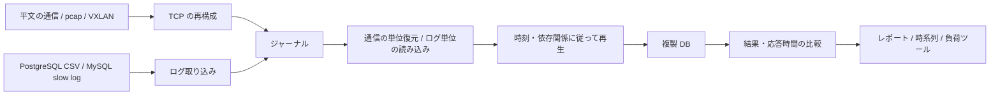

# dbtap

[English](README.md) | 日本語

[CI](https://github.com/beansandroasters/dbtap/actions/workflows/ci.yml) · [セキュリティ検査](https://github.com/beansandroasters/dbtap/actions/workflows/security.yml) · [報告方針](SECURITY.ja.md)

PostgreSQL / MySQL の通信または DB ログを記録し、別の DB に元の時系列で再生する CLI です。結果と応答時間を比べ、DB の移行・設定変更・性能評価に使います。

アプリケーションのコード変更は不要です。通信の取り込みは平文を対象にします。TLS 必須の環境では DB のクエリログを使えますが、ログ設定と保存先の容量が必要で、記録による DB への負荷も発生します。

## 対応範囲

| 入力 | 対応する形式 | 再生・比較できる情報 |
|---|---|---|
| PostgreSQL / MySQL の通信 | AF_PACKET、pcap / pcapng、VXLAN 内の TCP | プリペアド実行を含む要求、接続、時刻、エラー、行数・影響行数・結果ハッシュ |
| PostgreSQL ログ | PostgreSQL 17、UTF-8、26 列の CSV | SQL、テキストのバインド値、接続情報、時刻、SQLSTATE。結果の行数・内容は不明 |
| MySQL ログ | MySQL 8.4、FILE 形式の slow log、log_slow_extra=ON | 値を含む SQL、Thread_id、開始・終了時刻、Errno、Rows_sent |

Linux x86_64 で検証しています。通信の復元・再生は PostgreSQL 17 / MySQL 8.4、AWS では Aurora PostgreSQL 16.15 / RDS MySQL 8.0.46 での実測があります。これらの通信対応は、同じバージョンのログ入力への対応を意味しません。



## 最初に一通り試す

Linux x86_64、Rust / Cargo 1.93 以降、C/C++ ビルドツール、CMake が必要です。Docker を現在のアカウントで操作できること、[uv](https://docs.astral.sh/uv/getting-started/installation/) と sudo が使えることを確認してください。ソースを取得し、ルートディレクトリへ移動します。

```bash
git clone https://github.com/beansandroasters/dbtap.git
cd dbtap
```

```bash
rustc --version
cmake --version
docker info
uv --version
sudo -v
cargo build --release --locked
cargo test --workspace --locked
export PATH="$PWD/target/release:$PATH"
e2e/up.sh
```

`up.sh` は **同名の4コンテナとそのデータを削除して作り直します**。保存が必要な DB にこの名前を使わないでください。`ready` が出るまで待ちます。

| コンテナ | 用途 | ホスト側の接続先 |
|---|---|---|
| dbtap-pg-src | PostgreSQL 17 元 DB | 127.0.0.1:15432 |
| dbtap-pg-dst | PostgreSQL 17 複製 | 127.0.0.1:15433 |
| dbtap-my-src | MySQL 8.4 元 DB | 127.0.0.1:13306 |
| dbtap-my-dst | MySQL 8.4 複製 | 127.0.0.1:13307 |

DB は shop、利用者は postgres / root、検証専用パスワードは secret です。

```bash
e2e/run.sh
```

両方の DB に同じ初期データを入れ、元へ混合負荷を流しながら記録し、複製へ再生して最終テーブルを直接比較します。この通信経路のテストは loopback で明示的に平文を使います。末尾に出る `artifacts: /tmp/dbtap/e2e-XXXXXX` の実際のパスを次へ指定します。

```bash
dbtap inspect /tmp/dbtap/e2e-XXXXXX/cap.dbtap
dbtap report /tmp/dbtap/e2e-XXXXXX/report.json
```

欠落・再生不可・実行失敗・比較判定とテーブル比較の両方を確認します。終了コード0だけでは完全な再生を判定できません。採番 ID と時刻依存の結果は変わる場合があります。

DB が起動した状態なら、次にログ入力も試せます。各コマンドはテストデータを初期化するため、順番に実行します。

```bash
e2e/logs.sh          # PostgreSQL: 通信との照合、再生、最終状態比較
e2e/logs.sh --mysql  # MySQL
e2e/up.sh down       # 4コンテナと付属の匿名データボリュームを削除
```

`e2e/logs.sh --full` は COPY データがログにないため bulk に差が出ることを確認するテストです。出力ディレクトリは片付け後も残ります。SQL・値・TLS 検証の秘密鍵を含み得るため保護し、確認後に保存方針に従って削除してください。詳しくは [ローカル検証](e2e/README.ja.md)を参照してください。

## ビルド

Linux x86_64、Rust / Cargo 1.93 以降、C/C++ のビルドツール、CMake が必要です。DB クライアントライブラリのインストールは不要です。

```bash
cargo build --release --locked
export PATH="$PWD/target/release:$PATH"
./target/release/dbtap --help
```

テスト用スクリプトが不要で CLI だけを入れる場合は、最新の main からインストールできます。Rust とネイティブコードのビルド環境は同様に必要です。

```bash
cargo install --locked --git https://github.com/beansandroasters/dbtap dbtap-cli
dbtap --help
```

インストール先は通常 `~/.cargo/bin` です。必要なら PATH に追加してください。実験段階のソース配布で、バージョン付きバイナリリリースはまだありません。確認済みの版に固定するときは `cargo install` に `--rev COMMIT_SHA` を追加します。

以下はリポジトリのルートで実行します。ライブキャプチャには root または CAP_NET_RAW が必要です。ログ変換・ファイルからの取り込み・再生には不要です。

## 記録から比較まで

### 1. 記録する

平文の PostgreSQL / MySQL 通信を、対象インターフェイスで記録します。接続開始から記録すると、認証時の設定やプリペアド文を復元しやすくなります。

```bash
sudo ./target/release/dbtap capture --iface eth0 \
  --pg-port 5432 --mysql-port 3306 --duration 60 -o capture.dbtap
sudo chown "$(id -u)" capture.dbtap
```

pcap / pcapng は `capture --pcap input.pcap`、VXLAN はライブキャプチャに `--vxlan` を指定します。[通信の取り込み](docs/capture.ja.md)に権限、MTU、取りこぼしの注意をまとめています。

DB ログを使う場合は、[必要なログ設定](docs/log-input.ja.md)を適用して取得したファイルを変換します。

```bash
./target/release/dbtap import-logs --pg-csv postgresql.csv \
  --server source-pg:5432 --database shop -o pg.dbtap

./target/release/dbtap import-logs --mysql-slow mysql-slow.log \
  --server source-my:3306 --database shop -o mysql.dbtap
```

### 2. 記録を確認する

```bash
./target/release/dbtap inspect capture.dbtap
./target/release/dbtap inspect capture.dbtap --units
```

欠落、復元を諦めた接続、再生不可の単位、サーバー別の内訳を確認します。`--jsonl` は復元済みの単位と観測項目を機械可読で出力します。**SQL と値を含む出力です。**

### 3. 複製を用意して再生する

再生先には **記録開始時点のデータ**を用意します。スナップショット・特定時点復元・Aurora クローンなどを使い、アプリケーションからの通常の書き込みが混ざらない環境にします。

```bash
# 資格情報は Secrets Manager 等から環境変数 DBTAP_PASSWORD に設定する
./target/release/dbtap replay capture.dbtap \
  --pg clone-pg.example.internal:5432 --mysql clone-my.example.internal:3306 \
  --tls-ca trusted-ca.pem --report report.json --samples samples.jsonl --run-id trial1
```

TLS は既定で必須で、CA とホスト名を検証します。同梱の WebPKI ルート CA で検証できる場合は `--tls-ca` を省けます。OS の信頼ストアは自動で読み込みません。元の DB のパスワードを記録から取得して再生に使う機能はありません。

| 主なオプション | 用途 |
|---|---|
| `--pg` / `--mysql` | 再生先。使うエンジンだけ指定 |
| `--map 記録上のhost:port=再生先host:port` | サーバーごとの転送先。複数指定可 |
| `--user` / `--database` | 記録時の利用者・DB を上書き |
| `--init-sql SQL` | 接続直後の設定。記録前のセッション状態を補う |
| `--speed 2` | 相対的な予定時刻を半分に縮める |
| `--order row\|table\|time` | 依存関係の扱い。既定は `row` |
| `--lookahead 秒` / `--max-queued 件数` | 先読みの幅と待機中の単位数。既定 10 秒 / 100,000 件 |
| `--shard K/N` / `--start-at UNIX秒` | 複数プロセス・ホストへの分担と共通開始時刻 |
| `--report` / `--samples` | 集計 JSON / 要求ごとの実測時系列 |

全オプションは `dbtap replay --help`、順序と分散の仕様は [再生の設計](docs/architecture.ja.md)を参照してください。

### 4. 結果と最終状態を確認する

`report.json` の `failed`、`skipped`、`verdicts`、`compared` を確認し、元 DB と複製のテーブルも直接比較します。**終了コード 0 や Match だけでは、欠落のない再生・全結果の一致を判断できません。**

ログ由来では記録に残る項目だけを比較します。元と同じ DB エラーは比較上の Match でも、負荷ツールの要求失敗率には含まれます。[レポートの読み方](docs/reporting.ja.md)を参照してください。

## 負荷の時系列と分散実行

記録された SQL の構成、接続内の順序、要求の相対時刻を再現します。再生先が遅いと同じ接続の次の要求も遅れます。`--speed` は TPS の倍率を保証しません。CPU 使用率・I/O・ロック競合は再生先の構成とデータに依存します。

まず 1 台で開始し、CPU・メモリ・ファイル記述子・ネットワークと送信遅れ `lag` を測ります。送信能力が不足するときは接続を複数台に分担できます。**ホストをまたぐトランザクション依存関係は同期しません。** 全台で同じジャーナル一式と同期した時計が必要です。容量の上限と複数インスタンスでの Locust 実行は未検証です。

| ツール | 対応 |
|---|---|
| Locust 2.43.3 | 単独 / 固定ワーカーからの実行と集計 |
| JMeter 5.6.3 | JTL CSV 出力。HTML 生成を検証済み |
| k6 | Metric/Point JSON 出力。k6 本体からの実行は未対応 |

k6-web-dashboard v0.8.1 の集計には末尾欠落の制約があります。JMeter の未計測列、Locust の起動・停止と時刻の扱いを含め、[連携手順](integrations/README.ja.md)で対応範囲を確認してください。

## 制約

- 通信の取り込みは平文のみ。TLS 必須の環境では DB ログを使います。
- PostgreSQL ログには結果行数・内容・COPY の入力データがありません。MySQL スローログには構文解析できない文が残りません。取得漏れや記録しない SQL は復元できません。
- 記録前の SET、一時テーブル、未観測の PREPARE、複雑なトランザクション境界は完全には戻せません。通信由来とログ由来で要求の形・測定区間が異なります。
- `row` は SQL 中の値から依存関係を推定します。範囲検索・ビュー・ストアドの中のアクセスを完全には理解しません。切り分けには `table` を使えます。
- 重なった書き込みの可視化順、採番 ID、Writer / Reader 間のレプリケーション状態は保証しません。
- ミラーの MTU / snaplen を超えるパケットは切り詰められます。先読み幅より長い要求や依存関係の待ちで送信も遅れます。
- 待機中の単位数には上限がありますが、プロセス全体のメモリ使用量には上限がありません。
- LOAD DATA LOCAL INFILE、COM_CHANGE_USER、MySQL の圧縮・レプリケーション接続は再生しません。

## セキュリティと運用

ジャーナル・DB ログ・通常レポートには SQL、値、認証情報が含まれ得ます。出力は新規ファイルに 0600 で作成し、既存ファイルは上書きしません。記録を信頼できる経路で管理し、再生先は複製 DB、実行権限は対象の負荷に必要な範囲に制限します。

[SECURITY.md](SECURITY.ja.md)に資格情報・TLS・公開対象の扱い、[セキュリティ検査](docs/security.ja.md)に実装の保護と残る指摘を記載しています。AWS 資材は公開 IP なし・DB 非公開の検証用構成ですが、現在のテンプレート全体は実機未検証です。

## 開発・検証・詳細

```bash
cargo test --workspace --locked
uv run --project integrations --extra locust -m unittest discover -s integrations/tests -v
uv run --no-project -m unittest discover -s scripts/tests -v
```

| 文書 | 内容 |
|---|---|
| [通信の取り込み](docs/capture.ja.md) | AF_PACKET、pcap、VXLAN、MTU |
| [DB ログ入力](docs/log-input.ja.md) | 必要な設定、復元・比較項目、未対応の記録 |
| [再生の設計](docs/architecture.ja.md) | 単位、ジャーナル、依存関係、分散 |
| [レポート](docs/reporting.ja.md) | 判定、応答時間、終了コード |
| [実測](docs/validation.ja.md) | 測定条件、復元率、時刻差、TPS、未検証範囲 |
| [ローカル検証](e2e/README.ja.md) | DB の起動、記録、再生、最終状態比較、片付け |
| [AWS 検証資材](aws/README.ja.md) | 構成、設定、ログ取得、削除 |
| [公開前の確認](docs/publishing.ja.md) | 配布対象、ドキュメント・秘密情報・依存関係の検査 |

## ライセンス

[Apache License 2.0](LICENSE-APACHE) または [MIT License](LICENSE-MIT) を選択できます。変更の提供も同じデュアルライセンスで受け付けます。依存物は各ライセンスに従います。[第三者ライセンス](THIRD_PARTY_NOTICES.ja.md)と [開発ガイド](CONTRIBUTING.ja.md)を参照してください。
