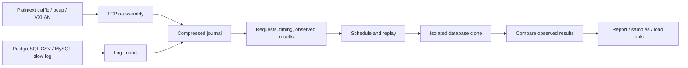

# dbtap

English | [日本語](README.ja.md)

[CI](https://github.com/beansandroasters/dbtap/actions/workflows/ci.yml) · [Security checks](https://github.com/beansandroasters/dbtap/actions/workflows/security.yml) · [Security policy](SECURITY.md)

Record PostgreSQL and MySQL workloads, replay their requests against a separate database on the recorded schedule, and compare results and response times. dbtap is a Rust command-line tool for migration checks, database comparisons, and repeatable load tests.

Two inputs are available:

- **A copy of plaintext traffic:** Linux AF_PACKET, pcap/pcapng, or VXLAN from VPC Traffic Mirroring. No application or database agent is required.
- **Database query logs:** PostgreSQL CSV logs or MySQL slow logs. These work when application connections require TLS, but enabling logging changes database configuration and adds work on the source database.

Replay uses TLS with certificate and hostname verification by default. dbtap executes the recorded SQL, including writes: use an isolated clone initialized to the state **before recording began**.



## What can be compared?

| Input | Requests | Original results available for comparison |
|---|---|---|
| Plaintext traffic | Protocol requests, including supported prepared statements | Errors, returned/affected rows, result fingerprints, response times |
| PostgreSQL 17 CSV | SQL and text bind values | Errors; duration for successful statements. No result rows or COPY data |
| MySQL 8.4 slow log with `log_slow_extra` | SQL with values, reconstructed as COM_QUERY | Errors, returned rows, Start/End timestamps. No result contents or affected-row counts |

A **unit** is one replayable request/response group, not necessarily one SQL statement or transaction. Reports state which fields were actually compared. Matching observed fields does not prove that every original request was recorded.

## Quick start: a complete local test

### 1. Prepare the host

Use Linux x86_64 with Rust/Cargo **1.93 or later**, a C/C++ build toolchain, CMake, Docker, and [uv](https://docs.astral.sh/uv/getting-started/installation/). The native crypto/compression dependencies need the build tools. Live capture needs `sudo` or CAP_NET_RAW; the test scripts use `sudo`. Docker must be usable by your account.

Clone the source and enter the repository:

```bash
git clone https://github.com/beansandroasters/dbtap.git
cd dbtap
```

Check the prerequisites and build:

```bash
rustc --version
cargo --version
cmake --version
docker info
uv --version
sudo -v
cargo build --release --locked
cargo test --workspace --locked
export PATH="$PWD/target/release:$PATH"
dbtap --help
```

The binary is `target/release/dbtap`. There is no daemon to start and no configuration file for the CLI. Other platforms and the maximum workload capacity have not been validated.

To install only the CLI from the latest `main` revision, without the test scripts:

```bash
cargo install --locked --git https://github.com/beansandroasters/dbtap dbtap-cli
dbtap --help
```

The Rust and native build prerequisites still apply. Cargo installs `dbtap` into its bin directory, usually `~/.cargo/bin`; add that directory to `PATH` if needed. This is an experimental source distribution; there are no versioned binary releases yet. Use `--rev COMMIT_SHA` with `cargo install` when pinning an evaluated revision.

### 2. Start disposable source and target databases

```bash
e2e/up.sh
```

This **replaces any containers with these four names**, including their data:

| Container | Role | Host address |
|---|---|---|
| `dbtap-pg-src` | PostgreSQL 17 source | `127.0.0.1:15432` |
| `dbtap-pg-dst` | PostgreSQL 17 clone | `127.0.0.1:15433` |
| `dbtap-my-src` | MySQL 8.4 source | `127.0.0.1:13306` |
| `dbtap-my-dst` | MySQL 8.4 clone | `127.0.0.1:13307` |

The test database is `shop`; the test users are `postgres` / `root`, with password `secret`. These credentials are only for the disposable local environment. Wait for `ready`.

### 3. Record, replay, and check the data

```bash
e2e/run.sh
```

The script seeds both databases with identical data, records a mixed workload against the sources, replays it against the targets, and directly compares the resulting tables. It uses plaintext on loopback explicitly for this capture test.

At the end, it prints `artifacts: /tmp/dbtap/e2e-XXXXXX`. Substitute that actual path below:

```bash
dbtap inspect /tmp/dbtap/e2e-XXXXXX/cap.dbtap
dbtap report /tmp/dbtap/e2e-XXXXXX/report.json
```

Check capture loss, incomplete connections, skipped units, execution failures, and comparison verdicts, as well as the table comparison. Some generated IDs and time-dependent results can differ. A replay exit code of 0 alone is not a correctness check; see [Reports](docs/reporting.md).

### 4. Try database logs

While the same containers are running:

```bash
e2e/logs.sh          # PostgreSQL: compare logs with traffic, replay, compare tables
e2e/logs.sh --mysql  # MySQL: the same workflow
```

Each test resets the test data and writes to a new directory. Run them sequentially. `e2e/logs.sh --full` additionally checks that PostgreSQL COPY data is missing from log input; that test expects a corresponding difference in the bulk table. See [Database log input](docs/log-input.md) for production-side settings and limits.

### 5. Clean up

```bash
e2e/up.sh down
```

This removes the four containers and their anonymous data volumes. Local output directories remain for inspection and can contain SQL, bind values, and test keys. Remove them when finished according to your data-retention policy. More test modes, TLS tests, and benchmarks are in [e2e/README.md](e2e/README.md).

## Use your own workload

### Prepare the data and select an input

Create an isolated target from the source's state at recording start, using a snapshot, point-in-time restore, or clone. Include the required schema, extensions, roles, and initial session settings. Keep normal application writes away from the target. dbtap does not create snapshots or discover the correct recovery point for you.

For plaintext traffic, start recording before connections and prepared statements are established:

```bash
umask 077
mkdir -p artifacts/trial1
sudo ./target/release/dbtap capture --iface eth0 \
  --pg-port 5432 --mysql-port 3306 --duration 60 -o artifacts/trial1/capture.dbtap
sudo chown "$(id -u)" artifacts/trial1/capture.dbtap
```

Start the workload in another terminal during those 60 seconds. Omit the unused engine's port. For files, use `--pcap input.pcap`; for a mirror receiver, use `--vxlan`. See [Capture](docs/capture.md) for placement, permissions, and MTU limits.

For database logs, configure and collect a complete recording interval as described in [Log input](docs/log-input.md), then import one engine at a time:

```bash
dbtap import-logs --pg-csv postgresql.csv --server source-pg:5432 \
  --database shop -o artifacts/trial1/pg.dbtap

dbtap import-logs --mysql-slow mysql-slow.log --server source-my:3306 \
  --database shop -o artifacts/trial1/mysql.dbtap
```

The `--server` value identifies the recorded server; it is not contacted during import. Use new output paths for each run. dbtap refuses to overwrite existing journals, reports, or samples.

### Inspect and replay

```bash
dbtap inspect artifacts/trial1/pg.dbtap
dbtap inspect artifacts/trial1/pg.dbtap --units

# Set DBTAP_PASSWORD through your secret-management workflow first.
dbtap replay artifacts/trial1/pg.dbtap \
  --pg clone-pg.example.internal:5432 --user replay_user --database shop \
  --tls-ca trusted-ca.pem --report artifacts/trial1/report.json \
  --samples artifacts/trial1/samples.jsonl --run-id trial1
```

For MySQL use `--mysql clone-my.example.internal:3306`. Both destinations can be supplied for a journal containing both engines. Multiple journals can be passed as positional arguments. Set `DBTAP_PASSWORD` in the current process environment; recorded authentication messages are not reused as credentials. Do not put real passwords in command-line arguments.

TLS uses bundled WebPKI roots plus any `--tls-ca` PEM certificates. The OS trust store is not loaded automatically. The destination hostname must match the certificate. Omit `--tls-ca` only if a bundled root already validates the server.

| Option | Use |
|---|---|
| `--map recorded-host:port=target-host:port` | Route recorded servers separately; repeat as needed |
| `--user` / `--database` | Override the recorded user/database |
| `--init-sql SQL` | Supply initial session settings; repeat as needed |
| `--speed 2` | Halve scheduled intervals; actual TPS depends on the target |
| `--order row\|table\|time` | Choose dependency handling; default `row` |
| `--lookahead SECONDS` / `--max-queued COUNT` | Limit read-ahead; defaults 10 seconds / 100,000 units |
| `--shard K/N` / `--start-at UNIX_SECONDS` | Split connections across processes with a common start |
| `--report` / `--samples` | Summary JSON / measured request time series |

Run `dbtap replay --help` for all options. Read [Scheduling](docs/architecture.md) before changing dependency settings.

### Validate the outcome

Inspect `failed`, `skipped`, `verdicts`, and `compared` in the report, then compare source and target business data directly using stable keys. Restore the target to its initial state before replaying again. A matching recorded database error is a comparison Match, but remains a failed request for load-testing statistics.

## Load trends and multiple generators

Replay preserves the SQL mix, relative request schedule, and order within each connection. A slow response delays the next request on that connection. CPU usage, I/O, and lock contention depend on the target database and its data; they are not replayed metrics.

Start with one host and measure CPU, memory, file descriptors, network throughput, and send delay (`lag`). Rust/Tokio can use multiple cores. When sending capacity is insufficient, split connections across fixed workers. All workers need identical journals in the same order and synchronized clocks. **Dependencies between workers are not synchronized.** Validate correctness on one host first. Multi-instance capacity has not been measured.

| Tool | Integration |
|---|---|
| Locust 2.43.3 | Execute and collect results locally or with fixed workers |
| JMeter 5.6.3 | Export JTL; HTML report generation tested |
| k6 | Export Metric/Point JSON; no native k6 execution adapter |

See [Load-tool integrations](integrations/README.md) for commands and measurement semantics. k6-web-dashboard v0.8.1 has a documented end-of-file aggregation loss; its HTML is not a reliable total-count check for these exports.

## Limitations

- Traffic capture supports plaintext only. Log input works independently of application TLS but cannot restore data absent from the logs.
- PostgreSQL logs omit result rows and COPY payloads. MySQL slow logs omit statements that cannot be parsed. Logging thresholds, sampling, or missing files can silently omit requests.
- Pre-existing SET state, temporary tables, unseen PREPARE requests, complex transaction boundaries, binary formats, and pipeline boundaries cannot always be reconstructed.
- `row` dependencies are inferred from SQL values; ranges, views, and stored-procedure internals are not fully understood. `table` is more conservative.
- Concurrent write visibility, generated IDs, and replication state between writers/readers are not guaranteed.
- Capture MTU/snaplen truncation loses data. Long requests beyond the read-ahead window and dependency waits can delay sending.
- Queue limits do not bound total process memory.
- LOAD DATA LOCAL INFILE, COM_CHANGE_USER, MySQL compression, and replication connections are unsupported.

## Security

Journals, logs, reports, and console output can contain SQL, values, authentication material, and database details. New dbtap output files use mode 0600 on Unix, but are not encrypted by dbtap. Use trusted inputs, protected storage, limited database permissions, and isolated replay targets. There is no automatic production-target detection.

Read [SECURITY.md](SECURITY.md) for the security policy and private reporting instructions, and [Security review](docs/security.md) for protections and remaining findings. The private AWS test template has static checks; deployment of the complete current template is unverified.

## Documentation and development

| Document | Contents |
|---|---|
| [Capture](docs/capture.md) | AF_PACKET, pcap, VXLAN, placement and MTU |
| [Log input](docs/log-input.md) | Settings, supported fields, collection boundaries |
| [Architecture](docs/architecture.md) | Journal, units, scheduling, dependencies and sharding |
| [Reports](docs/reporting.md) | Verdicts, timing, exit codes and automation |
| [Measurements](docs/validation.md) | Actual recovery rates, timing, TPS and untested scope |
| [Local tests](e2e/README.md) | Reproducible tests and cleanup |
| [AWS tests](aws/README.md) | Private infrastructure, logs and cleanup |
| [Contributing](CONTRIBUTING.md) | English-first documentation/comments and checks |
| [Publication checklist](docs/publishing.md) | Source selection, licenses, audits and release settings |

## License

Licensed under either the [Apache License, Version 2.0](LICENSE-APACHE) or the [MIT License](LICENSE-MIT), at your option. Contributions are accepted under the same dual license unless explicitly stated otherwise. Third-party dependencies retain their own licenses; see [Third-party notices](THIRD_PARTY_NOTICES.md).
