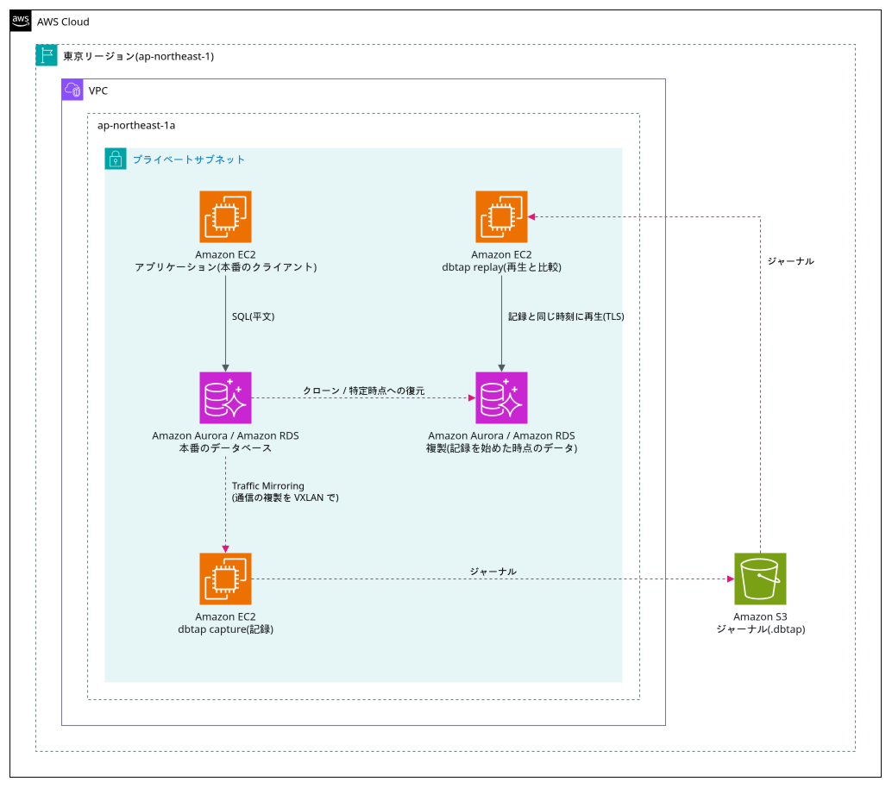

# AWS 検証資材

[English](README.md) | 日本語

東京リージョン (ap-northeast-1) に非公開の DB と記録・再生ホストを配置する CloudFormation テンプレートです。継続運用用の基盤ではなく、使い捨ての検証環境を対象にします。

## 構成

`verify.yaml`(CloudFormation)が作るもの:

- VPC(10.77.0.0/16)とプライベートサブネット 2 つ。**インターネットゲートウェイも NAT もなく、公開 IP を持つリソースはない**
- VPC エンドポイント(ssm / ssmmessages / ec2messages / secretsmanager と、S3 のゲートウェイ)。EC2 の操作は SSM、資材と AL2023 のパッケージは S3 経由
- EC2 2 台: 負荷と再生用(c6i.xlarge)、ミラーの受け側(c6i.large)
- Aurora PostgreSQL(db.r6g.large)と RDS MySQL(db.m6g.large)。どちらも非公開・保存時暗号化。受信は負荷用 EC2 のセキュリティグループからだけ
- Traffic Mirroring の受け側とフィルタ(セッションは、DB のインターフェイスが分かってから CLI で張る)
- 資材置き場の S3 バケット(Block Public Access の 4 フラグすべて有効、TLS 強制、7 日で失効)
- Secrets Manager が作る検証用 DB パスワード。読み取りは負荷用 EC2 のロールだけに許可
- VPC Flow Logs (CloudWatch Logs、7 日保持)

外向き通信は DB / VPC エンドポイント / リージョンの S3 prefix list に限定します。ミラーフィルタは VPC 内の 5432 / 3306 だけです。既定で DB の TLS を必須にし、平文の通信記録を検証するときだけ `PlaintextWireTest=true` を指定します。ログ入力では TLS を維持します。

現在のテンプレート全体の実機検証は未実施です。静的検査は cfn-lint 通過、Checkov 76 件通過・9 件指摘。CMK、S3 アクセスログとバージョニング、IAM DB 認証、拡張モニタリング、MySQL の Multi-AZ が未設定です。[セキュリティ検査](../docs/security.ja.md)と[実測の条件](../docs/validation.ja.md)を確認してください。



図は通信記録の配置例です。テンプレートの全リソース・AZ・ログ入力経路を列挙したものではありません。編集用 XML は [draw.io ファイル](../docs/dbtap-on-aws.drawio)と PNG 内にあります。

## 手順

`lib.sh` を読み込むと、`AWS_PROFILE=default` と東京リージョンが設定され、`out <出力名>`(スタックの出力)と `ssm <インスタンス> <秒>`(標準入力のスクリプトをインスタンス上で実行)が使えます。

```bash
source aws/lib.sh
uvx cfn-lint aws/verify.yaml --regions ap-northeast-1
uv run aws/check_security.py
s3pl=$(aws ec2 describe-prefix-lists --filters "Name=prefix-list-name,Values=com.amazonaws.${AWS_REGION}.s3" \
  --query 'PrefixLists[0].PrefixListId' --output text)
aws cloudformation create-stack --stack-name $STACK --template-body file://aws/verify.yaml --capabilities CAPABILITY_IAM \
  --parameters ParameterKey=S3PrefixListId,ParameterValue="$s3pl" \
               ParameterKey=AuroraVersion,ParameterValue=16.15 ParameterKey=MysqlVersion,ParameterValue=8.0.46
aws cloudformation wait stack-create-complete --stack-name $STACK
```

パスワードを create-stack の引数や SSM のスクリプト本文へ埋め込む必要はありません。スタックの `DbSecret` 出力は ARN だけです。実行するホストで Secrets Manager から取得し、`DBTAP_PASSWORD` / `PGPASSWORD` などの環境変数で子プロセスへ渡します。SSM スクリプトでは `set -x` を使わず、取得した値を出力しません。検証用に 2 DB で共有するパスワードなので、長期運用の個別資格情報・ローテーションを備えた構成ではありません。

検証の流れ:

1. バイナリ・`mysql-workload.sh`・RDS の CA バンドルを S3 に置き、2 台の EC2 に配る。負荷用には `postgresql16`、`postgresql16-contrib`(pgbench)、`mariadb105` を入れる
2. 元の DB に初期データを入れる(Aurora は `pgbench -i -s 10`、MySQL は accounts 50 行)
3. DB のインターフェイス(説明が `RDSNetworkInterface`)を探し、`aws ec2 create-traffic-mirror-session` でセッションを張る
4. 複製を作る。Aurora は `restore-db-cluster-to-point-in-time --restore-type copy-on-write --use-latest-restorable-time` とインスタンスの追加、RDS MySQL は `restore-db-instance-to-point-in-time --use-latest-restorable-time`。作る前に、復元できる最新時刻が初期データの投入より後になっていることを確かめる
5. 平文の記録検証では作成時に `PlaintextWireTest=true` を追加した環境で、受け側の `dbtap capture --iface ens5 --vxlan ...` と負荷側の記録を始める。ログを入力にする検証では TLS を維持し、DB ログを取得する
6. ジャーナルを S3 経由で負荷側へ渡し、`dbtap replay <ジャーナル> --map <記録上の IP:ポート>=<複製のエンドポイント>:<ポート> --tls require --tls-ca global-bundle.pem` で再生する
7. 元と複製の最終状態を比べる

### MySQL の負荷スクリプト

`mysql-workload.sh` は AL2023 の `mariadb105` クライアントを使い、初期化済みの shop DB に負荷をかけます。資格情報は実行ホストで取得して環境変数へ渡します。

```bash
source aws/lib.sh
# DBTAP_DB_SECRET_ARN に管理端末の out DbSecret が返した ARN を設定する
# EC2 のインスタンスロールを使う場合は unset AWS_PROFILE
export MYSQL_PWD="$(aws secretsmanager get-secret-value --secret-id "$DBTAP_DB_SECRET_ARN" --query SecretString --output text)"
export MYSQL_SSL_CA=/path/to/global-bundle.pem
aws/mysql-workload.sh clone.example.internal admin 8 100
unset MYSQL_PWD
```

既定では CA とホスト名を検証する TLS 接続です。平文の記録検証には、テンプレートの `PlaintextWireTest=true` と、実行ホストの `DBTAP_PLAINTEXT_TEST=1` の両方を明示します。パスワードは引数へ渡さず、SQL 用の一時ファイルは 0700 の一時ディレクトリに置いて終了時に削除します。接続のいずれかが失敗した場合は非 0 で終了します。

### ミラーセッションの識別

元 DB の ENI を確認し、削除対象を識別できるタグを付けます。

```bash
source aws/lib.sh
# db_eni に、対象 DB のエンドポイント IP と対応する ENI を設定する
aws ec2 create-traffic-mirror-session --network-interface-id "$db_eni" \
  --traffic-mirror-target-id "$(out MirrorTarget)" --traffic-mirror-filter-id "$(out MirrorFilter)" \
  --session-number 1 --tag-specifications 'ResourceType=traffic-mirror-session,Tags=[{Key=project,Value=dbtap-verify}]'
```

## DB ログの設定と取得

2026-11-14 時点のパラメータ定義では、次の設定が変更可能です。**RDS / Aurora 上の実ログ取り込み・再生は未検証です。** [ローカルの検証結果](../docs/validation.ja.md)と[パラメータ定義 JSON](../docs/aws-log-parameters-20261114.json)を参照してください。

| エンジンのパラメータファミリー | 確認した設定 |
|---|---|
| `postgres17` | `log_destination` に csvlog を指定可能。`log_min_duration_statement`、接続・切断の記録、パラメータ長を変更可能 |
| `aurora-postgresql17` | 同様。`log_destination` の許容値は stderr,csvlog |
| `mysql8.4` | `log_output=FILE`、`log_slow_extra=ON`、`long_query_time=0`、`slow_query_log=ON` を指定可能 |
| `aurora-mysql8.0` / `aurora-mysql8.4` | 同じ項目を変更可能。boolean の許容値は 0,1 |

上記の確認項目は dynamic / IsModifiable=true でした。これは設定項目が用意されていることの確認です。実際のエンジンバージョンに合うカスタムパラメータグループを用意し、関連付けと反映状態、SQL から見た値を確認してください。PostgreSQL の `log_timezone` は UTC・変更不可でした。Aurora はパラメータによって DB / クラスタのグループが異なるため、対象エンジンのグループで確認します。

必要な値の一覧は [ログの設定](../docs/log-input.ja.md#設定と使い方)を参照してください。MySQL の GLOBAL 値が変わっても、接続プールの既存セッションの `long_query_time` は変わりません。新規接続で SESSION の値を確認します。RDS PostgreSQL / Aurora PostgreSQL は csvlog を選んでも stderr のログも生成するため、CSV 単体の実測量より保存量が増えます。

API の定義を確認する例:

```bash
source aws/lib.sh
aws rds describe-engine-default-parameters --db-parameter-group-family postgres17
aws rds describe-engine-default-parameters --db-parameter-group-family mysql8.4
aws rds describe-engine-default-parameters --db-parameter-group-family aurora-postgresql17
aws rds describe-engine-default-parameters --db-parameter-group-family aurora-mysql8.4
```

取得には DB インスタンス単位のログ一覧と `DownloadDBLogFilePortion` を使えます。Aurora でも Writer / Reader それぞれのインスタンスが対象です。保持期間内のファイルをすべて確認し、ローテーション済みのファイルを取得してください。まだ書かれているファイルでは、取得の途中に増えた分や切り替えの境界を別途管理する必要があります。

```bash
source aws/lib.sh
aws rds describe-db-log-files --db-instance-identifier <instance-id> \
  --query 'DescribeDBLogFiles[].[LogFileName,LastWritten,Size]' --output table

# 一覧が返した LogFileName をそのまま渡す。CSV なら .csv のファイルを選ぶ。
uv run aws/download-log.py <instance-id> <LogFileName> postgresql.csv
```

`download-log.py` は Marker=0 から始め、AdditionalDataPending=false になるまで読み、LogFileData を改変せず連結します。1 回の取得は最大 1 MB なので、1 回だけのダウンロードでは完全とは限りません。CSV の引用中に改行があっても、API ページの境界に独自の改行を足しません。途中で失敗した場合は `.partial` だけを残し、完成ファイルを公開しません。この補助スクリプトの実 DB に対する動作は未検証です。

継続的な運用では CloudWatch Logs へのエクスポートも選べます。ただし dbtap が現在受け付けるのは元の CSV / FILE スローログです。CloudWatch のイベントを単に行として並べたものが同じ形式になるとは扱っていません。

公式資料:

- [RDS PostgreSQL のログパラメータ](https://docs.aws.amazon.com/AmazonRDS/latest/UserGuide/USER_LogAccess.Concepts.PostgreSQL.overview.parameter-groups.html)
- [Aurora PostgreSQL のログパラメータ](https://docs.aws.amazon.com/AmazonRDS/latest/AuroraUserGuide/USER_LogAccess.Concepts.PostgreSQL.overview.parameter-groups.html)
- [RDS MySQL のログ設定](https://aws.amazon.com/blogs/database/performance-optimization-strategies-for-mysql-on-amazon-rds/)
- [DownloadDBLogFilePortion のページング仕様](https://docs.aws.amazon.com/boto3/latest/reference/services/rds/client/download_db_log_file_portion.html)

## 片付け

```bash
source aws/lib.sh
for s in $(aws ec2 describe-traffic-mirror-sessions --filters Name=tag:project,Values=dbtap-verify --query 'TrafficMirrorSessions[].TrafficMirrorSessionId' --output text); do
  aws ec2 delete-traffic-mirror-session --traffic-mirror-session-id $s
done
# 複製(スタックの外で作ったもの)を先に消す。スタックのサブネットグループやセキュリティグループを使っているため
aws s3 rm s3://$(out Bucket) --recursive
aws cloudformation delete-stack --stack-name $STACK
```

スタックの削除完了を確認し、スタック外に作った複製・ミラーセッション・スナップショットが残っていないことを確認します。S3 の全削除とスタック削除は取り消せません。検証結果を保存する場合は必要な集計を先に取り出します。
