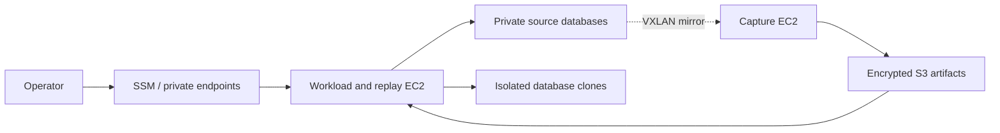

# AWS validation infrastructure

English | [日本語](README.ja.md)

The CloudFormation template creates private databases and capture/replay hosts in **ap-northeast-1 (Tokyo)** for disposable tests, not ongoing production operation. It creates billable resources. Deployment of the complete current template is unverified; wire measurements and static checks have distinct scopes.

## Resources and boundaries

`verify.yaml` defines:

- VPC `10.77.0.0/16`, two private subnets, **no IGW, NAT, or public IPs**.
- Interface endpoints for ssm, ssmmessages, ec2messages, secretsmanager, and an S3 gateway endpoint. EC2 access uses SSM; artifacts and AL2023 packages use S3.
- Two EC2 instances: c6i.xlarge for workload/replay and c6i.large for mirror capture.
- Private, encrypted Aurora PostgreSQL db.r6g.large and RDS MySQL db.m6g.large, accepting only the workload security group.
- Traffic Mirror target/filter; sessions are created after DB ENIs are known.
- S3 artifacts bucket with all public-access blocks, TLS-only access, and seven-day expiration.
- Generated Secrets Manager DB password, readable only by the workload role.
- VPC Flow Logs to CloudWatch Logs, retained seven days.

Egress is limited to DBs/endpoints and the regional S3 prefix list. Mirror filters select VPC traffic on 5432/3306. DB TLS is required by default. Only explicit `PlaintextWireTest=true` permits the isolated plaintext capture test; keep TLS for log input.

Static validation: cfn-lint clean, 76 Checkov passes and nine findings. Customer-managed keys, S3 access logging/versioning, IAM DB authentication, enhanced monitoring, and MySQL Multi-AZ are absent. Read [Security review](../docs/security.md) and [measurement conditions](../docs/validation.md).



This is a conceptual flow, not every resource/AZ. Detailed editable [draw.io](../docs/dbtap-on-aws.drawio) and [PNG](../docs/dbtap-on-aws.drawio.png) use Japanese labels.

## Prepare and create the test stack

From the repository root, use AWS CLI credentials authorized for the test. `source aws/lib.sh` sets **AWS_PROFILE=default and Tokyo**, preventing an inherited region from selecting another region. It defines `out NAME` for stack outputs and `ssm INSTANCE SECONDS` to run a script supplied on stdin.

```bash
source aws/lib.sh
uvx cfn-lint aws/verify.yaml --regions ap-northeast-1
uv run aws/check_security.py
s3pl=$(aws ec2 describe-prefix-lists --filters "Name=prefix-list-name,Values=com.amazonaws.${AWS_REGION}.s3" \
  --query 'PrefixLists[0].PrefixListId' --output text)
aws cloudformation create-stack --stack-name "$STACK" --template-body file://aws/verify.yaml --capabilities CAPABILITY_IAM \
  --parameters ParameterKey=S3PrefixListId,ParameterValue="$s3pl" \
               ParameterKey=AuroraVersion,ParameterValue=16.15 ParameterKey=MysqlVersion,ParameterValue=8.0.46
aws cloudformation wait stack-create-complete --stack-name "$STACK"
```

Check engine-version availability before creation. Those versions reproduce the wire-test environment; PostgreSQL 17/MySQL 8.4 log input requires matching engine versions and parameter groups. Adding `PlaintextWireTest=true` is only needed for the plaintext wire test.

Do not put passwords in stack arguments or SSM script bodies. `DbSecret` outputs an ARN, not its value. Retrieve the secret on the execution host and pass it through `DBTAP_PASSWORD`, `PGPASSWORD`, or `MYSQL_PWD`. Do not use `set -x` or print the retrieved value. The shared password across two test DBs is not a rotation design for long-term operation.

## Test workflow

1. Upload the binary, `mysql-workload.sh`, and RDS CA bundle to S3 and distribute them to EC2. Install `postgresql16`, `postgresql16-contrib` (pgbench), and `mariadb105` on the workload host.
2. Initialize source data: Aurora pgbench scale 10 and MySQL accounts with 50 rows.
3. Match source DB endpoint IPs to ENIs described as `RDSNetworkInterface`; create tagged mirror sessions only for those ENIs.
4. Prepare clones before workload execution. Aurora uses `restore-db-cluster-to-point-in-time --restore-type copy-on-write --use-latest-restorable-time` plus an instance; MySQL uses `restore-db-instance-to-point-in-time --use-latest-restorable-time`. Confirm the latest restorable time includes initialization and excludes the workload. Keep restores private and encrypted.
5. For a plaintext test, capture on receiver `ens5` with `--vxlan` and directly on the workload host. For log input, retain TLS and collect DB logs.
6. Transfer journals through S3 and replay with `--map recorded-ip:port=clone-endpoint:port --tls require --tls-ca global-bundle.pem`.
7. Check the report and directly compare source/clone final data. Restore the initial clone state before repeating.

These are operator steps, not an automated deployment test. The current endpoint/IAM restrictions, package retrieval, and Flow Logs delivery still need live validation.

### MySQL workload helper

The helper uses AL2023 `mariadb105` against an initialized `shop` database. On the execution host:

```bash
source aws/lib.sh
# Set DBTAP_DB_SECRET_ARN to the ARN returned by out DbSecret on the management host.
# When using the EC2 instance role, unset AWS_PROFILE first.
export MYSQL_PWD="$(aws secretsmanager get-secret-value --secret-id "$DBTAP_DB_SECRET_ARN" --query SecretString --output text)"
export MYSQL_SSL_CA=/path/to/global-bundle.pem
aws/mysql-workload.sh clone.example.internal admin 8 100
unset MYSQL_PWD
```

TLS validates CA and hostname by default. A plaintext test requires both stack `PlaintextWireTest=true` and execution-host `DBTAP_PLAINTEXT_TEST=1`. Passwords are not arguments. Temporary SQL is protected in a 0700 directory and removed on exit; any child failure produces nonzero exit. Fake-client tests cover those properties; this helper's real AWS/MariaDB connection is unvalidated.

### Identify mirror sessions for cleanup

```bash
source aws/lib.sh
# Set db_eni to the verified source DB ENI.
aws ec2 create-traffic-mirror-session --network-interface-id "$db_eni" \
  --traffic-mirror-target-id "$(out MirrorTarget)" --traffic-mirror-filter-id "$(out MirrorFilter)" \
  --session-number 1 --tag-specifications 'ResourceType=traffic-mirror-session,Tags=[{Key=project,Value=dbtap-verify}]'
```

## Database log settings and retrieval

Parameter definitions checked on 2026-11-14 expose the following settings. **Actual RDS/Aurora log import/replay is untested.** See [parameter evidence](../docs/aws-log-parameters-20261114.json) and [local measurements](../docs/validation.md).

| Parameter family | Confirmed settings |
|---|---|
| postgres17 | csvlog destination, statement duration, connection/disconnection logging, parameter lengths |
| aurora-postgresql17 | Same; allowed destination includes stderr,csvlog |
| mysql8.4 | log_output=FILE, log_slow_extra=ON, long_query_time=0, slow_query_log=ON |
| aurora-mysql8.0 / aurora-mysql8.4 | Same fields; booleans accept 0,1 |

Checked fields were dynamic and IsModifiable=true. This establishes parameter availability only. Use a matching custom parameter group, verify its association/apply status, and inspect effective SQL values. PostgreSQL log_timezone was fixed to UTC. Aurora uses DB or cluster groups depending on the parameter.

Use the complete [log settings](../docs/log-input.md). MySQL GLOBAL changes do not update existing pooled sessions' long_query_time; verify SESSION values on fresh connections. RDS/Aurora PostgreSQL also generates stderr logs when csvlog is enabled, increasing storage beyond CSV-only measurements.

```bash
source aws/lib.sh
aws rds describe-engine-default-parameters --db-parameter-group-family postgres17
aws rds describe-engine-default-parameters --db-parameter-group-family mysql8.4
aws rds describe-engine-default-parameters --db-parameter-group-family aurora-postgresql17
aws rds describe-engine-default-parameters --db-parameter-group-family aurora-mysql8.4
```

List/download logs per DB instance, including each Aurora writer/reader. Select complete rotated files within retention. Files still being written require separate management of growth and rotation boundaries.

```bash
source aws/lib.sh
# Replace INSTANCE_ID and LOG_FILE_NAME with actual values returned by AWS.
aws rds describe-db-log-files --db-instance-identifier INSTANCE_ID \
  --query 'DescribeDBLogFiles[].[LogFileName,LastWritten,Size]' --output table
uv run aws/download-log.py INSTANCE_ID LOG_FILE_NAME postgresql.csv
```

Pass LogFileName exactly as listed, selecting `.csv` for PostgreSQL. The helper starts Marker=0, follows AdditionalDataPending, and concatenates LogFileData unchanged. A page is at most 1 MB; one call need not contain the entire file. It adds no newline at API boundaries and exposes only `.partial` on failure. The helper has not been exercised against a live AWS DB.

CloudWatch Logs export is an operational option, but dbtap accepts original CSV/FILE slow-log formats, not arbitrary concatenated CloudWatch events.

References: [RDS PG parameters](https://docs.aws.amazon.com/AmazonRDS/latest/UserGuide/USER_LogAccess.Concepts.PostgreSQL.overview.parameter-groups.html), [Aurora PG parameters](https://docs.aws.amazon.com/AmazonRDS/latest/AuroraUserGuide/USER_LogAccess.Concepts.PostgreSQL.overview.parameter-groups.html), [RDS MySQL logs](https://aws.amazon.com/blogs/database/performance-optimization-strategies-for-mysql-on-amazon-rds/), [download pagination](https://docs.aws.amazon.com/boto3/latest/reference/services/rds/client/download_db_log_file_portion.html).

## Cleanup

Save required aggregates first. Verify each target before irreversible deletion:

```bash
source aws/lib.sh
for s in $(aws ec2 describe-traffic-mirror-sessions --filters Name=tag:project,Values=dbtap-verify --query 'TrafficMirrorSessions[].TrafficMirrorSessionId' --output text); do
  aws ec2 delete-traffic-mirror-session --traffic-mirror-session-id "$s"
done
# Delete clones created outside the stack first; they reference its subnet/security groups.
aws s3 rm "s3://$(out Bucket)" --recursive
aws cloudformation delete-stack --stack-name "$STACK"
aws cloudformation wait stack-delete-complete --stack-name "$STACK"
```

Verify no out-of-stack clones, tagged mirror sessions, or snapshots remain. Emptying S3 and deleting the stack cannot be undone.
