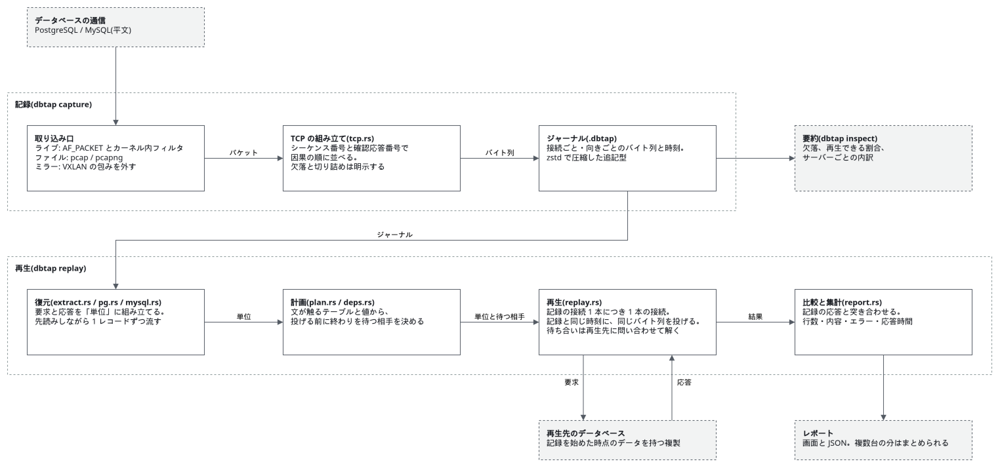

# 通信の取り込み

[English](capture.md) | 日本語

PostgreSQL / MySQL の平文 TCP を接続・向きごとのバイト列と時刻に復元し、ジャーナルへ保存します。TLS 接続は検出して数えますが、復元の対象外です。TLS 必須の環境では [DB ログ入力](log-input.ja.md)を使います。

## AF_PACKET

Linux の AF_PACKET と mmap リングを使います。root または CAP_NET_RAW が必要です。対象ポートはカーネル内でも絞ります。

```bash
sudo ./target/release/dbtap capture --iface eth0 \
  --pg-port 5432 --mysql-port 3306 --duration 60 -o capture.dbtap
sudo chown "$(id -u)" capture.dbtap
```

`--duration` を省くと Ctrl-C で停止します。停止時にリングの残りを読み切ります。ポートは複数指定でき、最大 32 個です。`--ring-mb` は既定 64 MiB、最大 4,096 MiB。インターフェイス指定時は既定で promiscuous mode を使い、`--no-promisc` で無効にできます。

| 配置 | キャプチャ場所 | 条件 |
|---|---|---|
| 自前の DB ホスト | DB ホストのインターフェイス | 全クライアントの通信を観測できること |
| クライアントホスト | アプリから DB へ向かうインターフェイス | 複数ホストの記録は再生時にまとめて渡す |
| RDS / Aurora | Traffic Mirroring の受信 EC2 | ミラー対応の DB ENI、対象通信、UDP 4789 の到達性 |

## pcap / pcapng

```bash
sudo tcpdump -i eth0 -s 0 -w input.pcap 'tcp port 5432 or tcp port 3306'
# 負荷停止後に 2 秒程度待ってから tcpdump を停止する
sudo chown "$(id -u)" input.pcap
./target/release/dbtap capture --pcap input.pcap \
  --pg-port 5432 --mysql-port 3306 -o capture.dbtap
```

`--pcap -` は標準入力です。pcap / pcapng の取り込みには root 権限は不要です。tcpdump は停止時に未読の末尾が残ることがあるため、負荷を先に止めて待ちます。snaplen による切り詰めも欠落として記録します。

## VXLAN / VPC Traffic Mirroring

```bash
sudo ./target/release/dbtap capture --iface eth0 --vxlan \
  --pg-port 5432 --mysql-port 3306 -o mirrored.dbtap
```

ミラー受信ホストで実行します。受信 SG の UDP 4789 はミラー元のネットワークに限定します。AWS の構成と手順は [aws/README.md](../aws/README.ja.md)を参照してください。

VXLAN の追加ヘッダーで受信側 MTU を超えると、パケットの末尾が失われます。MTU 9001 の VPC 内通信では、クライアント側を 8951 以下にする対策を実測しています。MTU の変更はアプリケーション環境への変更に当たります。変更できない場合はクライアント側での記録など、切り詰められない経路を選びます。

## 記録の完全性

`inspect` で欠落、復元できなかった接続、途中からの接続、再生不可の単位を確認します。欠落後は境界を探し直しますが、失われた要求や応答は戻せません。接続開始・認証・PREPARE を含む記録を推奨します。接続プールでは一部の接続が長く維持されるため、記録時間を長くしても完全性を保証しません。

ジャーナルには問い合わせの値や認証メッセージも含まれ得ます。保存・転送・共有の扱いは [SECURITY.md](../SECURITY.ja.md)に従ってください。



図は通信経路の詳細です。ログ入力を含む全体図は [README](../README.ja.md)にあります。draw.io の編集用 XML は [dbtap-pipeline.drawio](dbtap-pipeline.drawio) と PNG 内に保存しています。

公式資料: [Traffic mirror sources](https://docs.aws.amazon.com/vpc/latest/mirroring/traffic-mirroring-sessions.html)、[制約](https://docs.aws.amazon.com/vpc/latest/mirroring/traffic-mirroring-network-limitations.html)、[パケット形式](https://docs.aws.amazon.com/vpc/latest/mirroring/traffic-mirroring-packet-formats.html)。
