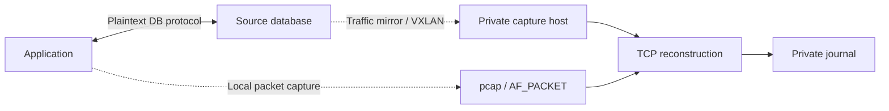

# Traffic capture

English | [日本語](capture.ja.md)

Capture reconstructs plaintext PostgreSQL/MySQL TCP streams by connection, direction, and timestamp, then writes a journal. TLS connections are detected and counted but are outside wire reconstruction. Use [database logs](log-input.md) when application connections require TLS.

## Live capture with AF_PACKET

Linux AF_PACKET uses an mmap ring and requires root or CAP_NET_RAW. A kernel filter restricts the selected ports.

```bash
sudo ./target/release/dbtap capture --iface eth0 \
  --pg-port 5432 --mysql-port 3306 --duration 60 -o capture.dbtap
sudo chown "$(id -u)" capture.dbtap
```

Choose the interface carrying the traffic and start before the workload. Omit `--duration` to stop with Ctrl-C; the remaining ring contents are drained on shutdown. Repeat port options as needed, up to 32 ports. `--ring-mb` defaults to 64 MiB and accepts at most 4,096 MiB. Specifying an interface enables promiscuous mode by default; `--no-promisc` disables it. Offline parsing and replay do not need capture privileges.

| Placement | Capture point | Requirement |
|---|---|---|
| Self-managed DB host | Database interface | Both directions for all relevant clients must be visible |
| Application host | Interface toward the DB | Pass journals from all participating hosts together at replay |
| RDS / Aurora | EC2 mirror receiver | A supported DB ENI, selected traffic, and UDP 4789 reachability |

## pcap / pcapng

```bash
sudo tcpdump -i eth0 -s 0 -w input.pcap 'tcp port 5432 or tcp port 3306'
# Stop the workload, wait about two seconds, then stop tcpdump with Ctrl-C.
sudo chown "$(id -u)" input.pcap
./target/release/dbtap capture --pcap input.pcap \
  --pg-port 5432 --mysql-port 3306 -o capture.dbtap
```

Use `--pcap -` for standard input. Importing pcap/pcapng does not require root. Stop the workload before tcpdump so its buffered tail can arrive. Truncation caused by snaplen is counted as loss. Protect tcpdump outputs with a private directory and restrictive permissions.

## VXLAN / VPC Traffic Mirroring

On the mirror receiver:

```bash
sudo ./target/release/dbtap capture --iface eth0 --vxlan \
  --pg-port 5432 --mysql-port 3306 -o mirrored.dbtap
```

Restrict inbound UDP 4789 to the mirror-source network. See [AWS setup](../aws/README.md).

VXLAN adds headers. Packets exceeding the receiver's MTU lose their tail. In the measured VPC with MTU 9001, reducing the client's MTU to 8951 prevented truncation. That is a change to the application environment. If it cannot be made, choose a capture point that does not truncate packets, such as the client host.



The detailed editable [draw.io source](dbtap-pipeline.drawio) and [PNG](dbtap-pipeline.drawio.png) have Japanese labels. The diagram above and [README](../README.md) describe the current English overview.

## Completeness

Use `inspect` to check loss, abandoned connections, connections captured mid-stream, and skipped units. After loss, dbtap searches for protocol boundaries, but cannot recreate missing requests or responses. Capture connection setup, authentication, and PREPARE where possible. Longer recording alone cannot guarantee completeness for long-lived connection pools.

Journals can contain values and authentication messages. Follow [SECURITY.md](../SECURITY.md) when storing, transferring, or sharing them.

References: [Mirror sources](https://docs.aws.amazon.com/vpc/latest/mirroring/traffic-mirroring-sessions.html), [network limitations](https://docs.aws.amazon.com/vpc/latest/mirroring/traffic-mirroring-network-limitations.html), [packet format](https://docs.aws.amazon.com/vpc/latest/mirroring/traffic-mirroring-packet-formats.html).
