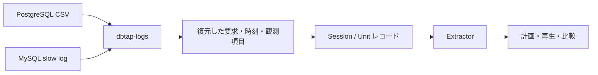

# DB ログから取り込む

[English](log-input.md) | 日本語

TLS 必須の環境でも、DB の公式なクエリログを入力にできます。実装は `crates/dbtap-logs/`、通し検証は `e2e/logs.sh` です。



## 設定と使い方

PostgreSQL は UTF-8 の **17 系・26 列の CSV** を対象にしています。次の設定で、成功した実行と失敗した文の両方を残します。

```conf
logging_collector = on             # 変更には再起動が必要
log_destination = 'csvlog'
log_timezone = 'UTC'
log_min_duration_statement = 0
log_statement = 'none'
log_duration = off
log_connections = on
log_disconnections = on
log_min_error_statement = error
log_parameter_max_length = -1
log_parameter_max_length_on_error = -1
```

`log_statement` と duration の両方で文を出す設定には対応していません。`log_statement=none` にして、所要時間の行に文を残します。`logging_collector` は先に用意し、その後の文の記録は再読み込みで切り替えられます。セッションで個別に上書きしていない接続では、既存接続への反映も確認しました。

MySQL は **8.4・`log_output=FILE`・`log_slow_extra=ON`** が必要です。

```sql
SET GLOBAL log_output = 'FILE';
SET GLOBAL log_slow_extra = ON;
SET GLOBAL long_query_time = 0;
SET GLOBAL min_examined_row_limit = 0;
SET GLOBAL log_slow_admin_statements = ON;
SET GLOBAL slow_query_log = ON;
```

**MySQL の `long_query_time` と `min_examined_row_limit` はセッション変数でもあります。** GLOBAL の変更後に接続を張り直すか、対象接続自身で SESSION の値を変更してください。既存接続の `long_query_time` が 10 秒のまま、新規接続だけ 0 秒になることを実測しました。スローログは接続認証や初期セッション設定を全部は残さないので、初期 DB と設定が分かる接続を対象にします。

ログの対象期間を確定し、ファイルを取り出してから変換します。

```bash
dbtap import-logs --pg-csv postgresql.csv --server source-pg:5432 \
  --database shop --application-prefix worker- -o pg-logs.dbtap

dbtap import-logs --mysql-slow mysql-slow.log --server source-my:3306 \
  --database shop --mysql-thread 123 --mysql-thread 124 -o my-logs.dbtap

dbtap inspect pg-logs.dbtap --units
dbtap replay pg-logs.dbtap --pg clone-pg:5432 --report pg-report.json
dbtap replay my-logs.dbtap --mysql clone-my:3306 --report my-report.json
```

`--server` は記録元を識別し、`--map` とサーバーごとの順序計画に使います。PostgreSQL の `--database` は絞り込み、MySQL では冒頭の `use` 行がない断片に与える初期 DB です。MySQL の絞り込みは `--mysql-thread` を使います。省くと全 Thread_id が対象です。

取り込みは完了時刻で並べ直します(`--sort-window-ms`、既定 1 秒)。窓より遅れて現れた古いレコードや、同じセッションの時刻逆転はエラーにします。窓内の保留は最大 100 万レコード、接続の管理情報はファイル内のセッション数に比例します。SQL 1 件のサイズにもメモリを使います。DB の再起動をまたぐ MySQL ファイルや、重複したファイルを連結しないでください。出力は新規ファイルだけに書き、変換途中では完成したジャーナルとして公開しません。

RDS / Aurora の設定可否と取得方法は [aws/README.md](../aws/README.ja.md#db-ログの設定と取得)にあります。AWS 上の DB ログを再生する通し検証は未実施です。パラメータ定義の確認範囲は AWS の手順を参照してください。

## 何を復元し、何を比較するか

| 項目 | PostgreSQL CSV | MySQL slow + extra |
|---|---|---|
| 実行 SQL | statement / execute の本文。parse / bind 行は実行として数えない | 値が展開された SQL。バイナリのプリペアド実行も COM_QUERY に組み直す |
| パラメータ | DETAIL / CONTEXT の値を text の Bind に戻す。NULL と文字列の NULL は区別 | 文中のリテラルとして残る |
| 開始・終了 | 終了はログの ms 時刻、開始はそこから所要時間を引く | extra の Start / End(µs) |
| 所要時間 | 成功時はあり。ERROR の行は不明 | Start / End の差 |
| エラー | SQLSTATE | Errno |
| 返した行数 | 不明 | Rows_sent |
| 影響行数・結果の内容 | 不明 | 不明。Rows_examined は影響行数ではない |
| セッション | session_id、利用者、DB、application_name、接続・切断 | Thread_id、利用者。Quit があれば終了を記録 |

PostgreSQL は、パラメータがあれば Parse / Bind / Execute / Sync、なければ Query を作ります。型 OID はサーバーに推論させます。元の型指定、バイナリ転送、プリペアド文のキャッシュ、パイプラインの Sync 境界、結果取得の区切りは戻りません。特にログの execute 所要時間には別行の parse / bind が含まれず、再生ではそれらも実行するため、応答時間の測定範囲が違います。

MySQL の Prepare / Close stmt / Reset stmt / Ping は実行 SQL として送りません。`use` はログの DB メタデータ、`SET timestamp` は元の実行時刻のメタデータとして読みます。`insert_id` / `last_insert_id` が付く形式では、その値だけを SET として要求の前に残します。時刻関数やマイクロ秒以下の結果が同じになる保証はありません。

各単位の `observed` とレポートの `compared` が、比較できる項目と実際に比較した件数を表します。**「観測した項目が一致」は、全結果の一致を意味しません。** PostgreSQL ではエラー、MySQL ではエラーと返した行数の一致です。応答時間は別途集計します。不明な所要時間は 0 として平均せず、記録と再生の両方からその組を除きます。文の形ごとの再生平均には全実行を含め、倍率は時間を比較できた組だけで計算します。

## ログからは戻せないもの

- PostgreSQL の COPY は、送るデータがないため再生しません。この実装は COPY を含む文を保守的に除外します。`execute fetch from ...` も、元の portal の続きなので再実行せず除外します
- PostgreSQL の欠けた・切り詰められたバインド値、PARSE / BIND 中のエラー、MySQL の LOAD / SQL EXECUTE と未対応の管理コマンドに依存する接続は、再生不可として数えます
- MySQL の構文解析できない文はスローログ自体にありません。1064 の文が残らず、実行時の重複キーエラー 1062 は残ることを実測しました。ログだけでは、この抜けを数えられません
- MySQL のログ中の `use` はファイル全体で省略されます。初期 DB 不明の接続や DB 未選択の接続が混ざる入力は対象外です。検出できた途中の DB 切り替えは再生不可にします
- UTF-8 と通常の SQL 引用規則を前提にします。元の charset、SQL mode、記録前の SET、一時テーブルなどは復元しません。`--database` / `--init-sql` で補える範囲を確かめてください
- トランザクション状態は明示的な BEGIN / COMMIT / ROLLBACK と MySQL の autocommit 操作からの近似です。暗黙の境界、複雑な SET、パイプラインのエラー処理まで同じにはなりません
- ログの先頭付近では、後から完了した長い要求の開始が再生の基準時刻より前にさかのぼることがあり、その部分の間隔は再現できません。先頭の長時間実行を含む負荷の時刻再現は未検証です
- しきい値、サンプリング、記録の途中開始、取得漏れでログに現れない SQL は取り戻せません。再生のレポートに加えて、元と複製の最終状態を必ず比べます

## 検証と参照資料

対応率・時刻差・ログ量・記録による TPS への影響は [検証結果](validation.ja.md) を参照してください。

[PostgreSQL 17 のログ設定](https://www.postgresql.org/docs/17/runtime-config-logging.html)、[MySQL 8.4 のスローログ](https://docs.oracle.com/cd/E17952_01/mysql-8.4-en/slow-query-log.html)、[MySQL の GLOBAL / SESSION 変数](https://docs.oracle.com/cd/E17952_01/mysql-8.4-en/using-system-variables.html)。
