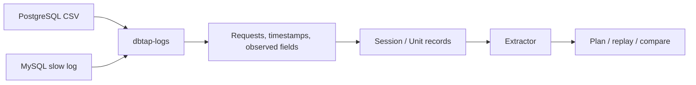

# Database log input

English | [日本語](log-input.ja.md)

Database query logs can record a workload even when application connections require TLS. The importer is in `crates/dbtap-logs/`; `e2e/logs.sh` compares it against traffic capture. Enabling logging requires database configuration and adds source-side work and storage; see [measurements](validation.md).



## PostgreSQL setup

The importer targets **PostgreSQL 17, UTF-8, 26-column CSV**. Configure the source to record successful executions and failed statements:

```conf
logging_collector = on             # Requires a restart to change
log_destination = 'csvlog'
log_timezone = 'UTC'
log_min_duration_statement = 0
log_statement = 'none'
log_duration = off
log_connections = on
log_disconnections = on
log_min_error_statement = error
log_parameter_max_length = -1
log_parameter_max_length_on_error = -1
```

Prepare `logging_collector` in advance. Statement logging can then be changed with configuration reloads. Existing sessions without a session-level override were observed to pick up the change. Record the previous settings so you can restore them after collection.

Do not enable both `log_statement` and duration-based statement output: this importer expects the SQL on duration lines. Unlimited parameter logging exposes the complete values; protect the files as database data.

## MySQL setup

The importer requires **MySQL 8.4, `log_output=FILE`, and `log_slow_extra=ON`**:

```sql
SET GLOBAL log_output = 'FILE';
SET GLOBAL log_slow_extra = ON;
SET GLOBAL long_query_time = 0;
SET GLOBAL min_examined_row_limit = 0;
SET GLOBAL log_slow_admin_statements = ON;
SET GLOBAL slow_query_log = ON;
```

**`long_query_time` and `min_examined_row_limit` also have session values.** Reconnect after changing GLOBAL values, or have each existing session set its own SESSION values. In testing, existing sessions retained a 10-second threshold while new sessions received 0. A GLOBAL change alone is insufficient for an existing connection pool.

The slow log does not record all authentication or initial session state. Use sessions with a known initial database and settings. Restore the previous logging configuration after collection.

## Collect, import, and replay

1. Prepare the clone at the start of the recording interval.
2. Enable the required logs before the relevant sessions/workload begin.
3. Stop the workload and let outstanding statements finish. Select complete, non-overlapping log files for that interval; do not cut through a CSV record or slow-log entry.
4. Retrieve the files over a protected path, then import to unused output names.

```bash
# From the repository root, after adding target/release to PATH.
umask 077
dbtap import-logs --pg-csv postgresql.csv --server source-pg:5432 \
  --database shop --application-prefix worker- -o pg-logs.dbtap

dbtap import-logs --mysql-slow mysql-slow.log --server source-my:3306 \
  --database shop --mysql-thread 123 --mysql-thread 124 -o my-logs.dbtap

dbtap inspect pg-logs.dbtap --units
# Set DBTAP_PASSWORD before replay; add --tls-ca for a private CA.
dbtap replay pg-logs.dbtap --pg clone-pg:5432 --report pg-report.json
dbtap replay my-logs.dbtap --mysql clone-my:3306 --report my-report.json
```

`--server` identifies the recorded server for routing with `--map` and dependency planning. For PostgreSQL, `--database` filters records. For MySQL it supplies the initial database for a fragment lacking an initial `use` line; filter with repeated `--mysql-thread`. Without thread filters, all Thread_id values are imported. Only use `--application-prefix` if your PostgreSQL sessions actually set that prefix.

Import sorts by completion time within `--sort-window-ms` (default 1,000 ms). Older records arriving beyond the window and reversed timestamps within a session are errors. At most one million pending records are retained in the window; session metadata grows with session count, and large SQL records also use memory. Do not concatenate duplicate files or MySQL files spanning a server restart. Failed imports are not exposed as finished journals; inspect/remove their `.partial` files before reusing an output name.

[RDS/Aurora settings and retrieval](../aws/README.md#database-log-settings-and-retrieval) are documented separately. Actual AWS log-to-replay execution has not been validated.

## Reconstructed and compared fields

| Field | PostgreSQL CSV | MySQL slow + extra |
|---|---|---|
| Executed SQL | statement / execute body; parse and bind lines are not executions | SQL with expanded values, including binary prepared executions reconstructed as COM_QUERY |
| Parameters | DETAIL / CONTEXT values become text Bind parameters; SQL NULL and the string NULL remain distinct | Literals in SQL |
| Start/end | Millisecond log completion timestamp; subtract duration for start | Extra Start / End in microseconds |
| Duration | Successful execution only; unknown for ERROR lines | End minus Start |
| Error | SQLSTATE | Errno |
| Returned rows | Unknown | Rows_sent |
| Affected rows / content | Unknown | Unknown; Rows_examined is not an affected-row count |
| Sessions | session_id, user, database, application_name, connection/disconnection | Thread_id, user; Quit closes a session if present |

PostgreSQL requests use Parse/Bind/Execute/Sync when parameters exist, otherwise Query. Type OIDs are inferred by the server. Original type declarations, binary transfer, prepared-statement caches, pipeline Sync boundaries, and fetch boundaries are not retained. Logged execute durations exclude separately logged parse/bind work, while replay performs that work, so response-time intervals differ.

MySQL Prepare / Close stmt / Reset stmt / Ping entries are not replayed as SQL. `use` and `SET timestamp` are treated as metadata. Where the log provides `insert_id` / `last_insert_id`, those assignments are retained before the request because they affect generated values. Identical time-function or sub-microsecond results are not guaranteed.

Each unit's `observed` and each report's `compared` identify available fields and counts actually compared. PostgreSQL log comparisons cover errors; MySQL covers errors and returned rows. Duration is aggregated separately. Unknown duration pairs are excluded from both sides of paired timing statistics, rather than treated as zero. Per-shape replay means include all executions; slowdown ratios use only pairs with known captured durations.

## What logs cannot restore

- PostgreSQL COPY lacks input data. Statements containing COPY are conservatively skipped. `execute fetch from ...` portal continuations are also skipped.
- Missing/truncated bind values, errors during PARSE/BIND, MySQL LOAD / SQL EXECUTE, and sessions depending on unsupported administrative commands can make units unreplayable.
- MySQL syntax errors are absent from the slow log. Error 1064 was absent in testing; runtime duplicate-key error 1062 was present. Log input alone cannot count omitted statements.
- MySQL suppresses repeated `use` lines across the whole file. Inputs mixing unknown initial databases or sessions without a selected database are unsupported. Detected mid-session database switches are marked unreplayable.
- UTF-8 and ordinary SQL quoting are assumed. Original charset, SQL mode, earlier SET statements, and temporary tables are not restored automatically. Check whether `--database` / `--init-sql` can supply the missing state.
- Transaction state is approximated from explicit BEGIN/COMMIT/ROLLBACK and MySQL autocommit. Implicit boundaries, complex SET expressions, and pipeline error recovery may differ.
- Near the start of a log, a long-running request completing later may have started before the replay time origin. That initial interval cannot be reproduced; this timing case is unvalidated.
- Thresholds, sampling, late recording, and missing downloads omit SQL irrecoverably. Always compare the final source and target data in addition to the replay report.

References: [PostgreSQL 17 logging](https://www.postgresql.org/docs/17/runtime-config-logging.html), [MySQL 8.4 slow log](https://docs.oracle.com/cd/E17952_01/mysql-8.4-en/slow-query-log.html), [GLOBAL/SESSION variables](https://docs.oracle.com/cd/E17952_01/mysql-8.4-en/using-system-variables.html).
